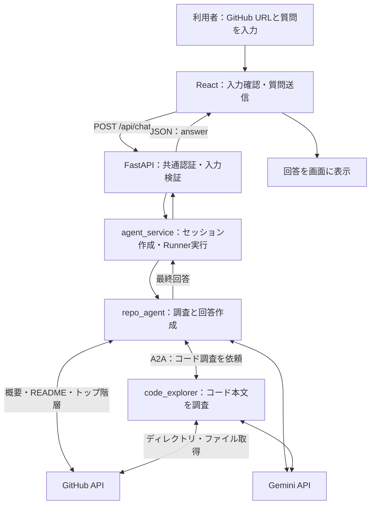

# GitHubレポジトリ理解エージェント

kaggleの「5-Day AI Agents Intensive Course with Google」に並行して独自で作成したAIエージェントです。day1からday5にかけて少しずつ内容を追加しています。エージェントが完成したので以下の技術を使用してWebアプリを作成し、クラウド上に公開しました。URLは<https://gitlearn-sna2kumn6a-an.a.run.app>です。


## ローカルでの起動方法

以下はWindowsのPowerShellで、Webアプリをローカル起動する手順です。フロントエンドをビルドし、FastAPIから画面とAPIを配信します。`code_explorer`とバックエンドを別々のターミナルで起動してください。

### 1. 事前準備

- Python 3.12（Dockerfileで使用しているバージョン）
- Node.js 22とnpm（Dockerfileで使用しているバージョン）
- Gemini APIを利用できるAPIキー
- Gemini API・GitHub APIへ接続できるインターネット環境

以下のコマンドはプロジェクト直下で実行します。保存先が異なる場合はパスを読み替えてください。

```powershell
Set-Location C:\Users\hirot\Projects_local\kaggle\gitLearn
python -m venv .venv
.\.venv\Scripts\python.exe -m pip install -r repo_agent\requirements.txt
Push-Location frontend
npm ci
npm run build
Pop-Location
```

既存の`.venv`を使用する場合、仮想環境の作成は不要です。以降は仮想環境内のPythonを直接指定するため、仮想環境の有効化は不要です。

### 2. 環境変数の設定

プロジェクト直下に`.env`を作成し、以下を設定します。既存のファイルがある場合は、必要な項目を追記・更新してください。

```dotenv
GOOGLE_GENAI_USE_VERTEXAI=FALSE
GOOGLE_API_KEY=取得したGemini_APIキー
SHARED_USERNAME=guest
SHARED_PASSWORD=ローカル開発用のランダムなASCII文字列に置き換える
```

| 環境変数 | 用途 |
|---|---|
| `GOOGLE_GENAI_USE_VERTEXAI` | この手順ではGemini APIキーを使用するため`FALSE`を指定 |
| `GOOGLE_API_KEY` | Gemini APIの認証キー |
| `SHARED_USERNAME` | ブラウザで入力する共通ユーザー名（省略時は`guest`） |
| `SHARED_PASSWORD` | ブラウザで入力する共通パスワード。16文字以上のASCII文字列を設定 |

APIキーとパスワードは実際の値に置き換えてください。`.env`はGitの管理対象外です。公開環境とは別のパスワードを使用してください。現在の実装では公開GitHubリポジトリを認証なしで取得するため、GitHubトークンの設定は不要です。

### 3. code_explorerの起動（ターミナル1）

```powershell
Set-Location C:\Users\hirot\Projects_local\kaggle\gitLearn
.\.venv\Scripts\python.exe -m uvicorn code_explorer.agent:a2a_app --host 127.0.0.1 --port 8002
```

起動後はターミナルを開いたままにします。`repo_agent`は`http://127.0.0.1:8002`の外部エージェントに接続します。Web版ではバックエンドが`repo_agent`を直接実行するため、`repo_agent`用の8001番ポートのサーバーは不要です。

### 4. バックエンドの起動（ターミナル2）

```powershell
Set-Location C:\Users\hirot\Projects_local\kaggle\gitLearn
.\.venv\Scripts\python.exe -m uvicorn backend.main:app --host 127.0.0.1 --port 19090
```

ブラウザで <http://127.0.0.1:19090/> を開き、認証ダイアログに`.env`の`SHARED_USERNAME`と`SHARED_PASSWORD`を入力します。Viteの開発サーバーを別途起動する必要はありません。

画面で公開GitHubリポジトリのURLと質問を入力し、「質問する」を押してください。

- URLの例：`https://github.com/google/adk-python`
- 質問の例：「このリポジトリの構成と、最初に読むとよいファイルを教えてください。」

回答まで数分かかる場合があります。Gemini APIの利用には料金が発生する場合があります。現在のWeb版では質問ごとに新しいセッションを作成するため、前回の質問内容は引き継ぎません。

### 5. 動作確認・終了

バックエンドの起動状態は、認証不要の <http://127.0.0.1:19090/api/health> で確認できます。正常時は`{"status":"ok"}`を返します。ただし、この確認だけではGemini APIや`code_explorer`への接続までは確認できません。

| 症状 | 確認すること |
|---|---|
| 503エラーになる | `SHARED_PASSWORD`が設定され、16文字以上になっているか。変更後はバックエンドを再起動する |
| 認証が通らない | `.env`のユーザー名・パスワードと入力内容が一致しているか |
| 画面が表示されない | `npm run build`が成功し、`frontend/dist`が作成されているか。ビルド後にバックエンドを再起動する |
| コード本文を調べられない | `code_explorer`が8002番ポートで起動しているか |
| Gemini APIの呼び出しに失敗する | APIキー、利用枠、コード内で指定しているモデルの利用可否、両ターミナルのログを確認する |

フロントエンドを変更した場合は`frontend`で`npm run build`を再実行してください。環境変数を変更した場合は両方のサーバーを再起動してください。終了するときは、それぞれのターミナルで`Ctrl+C`を押します。

クラウド上での共有・認証設定については[共通パスワードでの共有](docs/shared-access.md)を参照してください。

## 使用技術
- Python　3.12
- Google Agent Development Kit (ADK)
- Gemini API
- GitHub API
- A2Aプロトコル
- FastAPI
- React
- Docker
- Cloud Run

## ファイル構成
レポジトリの構成は以下のようになっています。

* repo_agent: 今回geminiAPIとADKを用いて作成したAIエージェントです。
* code_explorer: repo_agentがA2Aプロトコルを用いてツールとして呼び出す外部エージェントです。
* backend: FastAPIを実装し、フロントエンドからの質問とエージェントからの解答の送受信を行います。今回制限を設けるため、ユーザー認証もこのディレクトリ内で実装しています。
* frontend: 実際にユーザーに見える画面です。ここでURLと指示を入力します。

## 全体の処理の流れ

Reactの画面から質問を送信すると、FastAPIが認証と入力内容の検証を行い、ADKのRunnerを通して`repo_agent`を実行します。エージェントは質問に応じてGitHubの情報を取得し、コード本文の調査が必要な場合はA2Aプロトコルで`code_explorer`に依頼します。



1. 利用者が公開GitHubリポジトリのURLと質問を入力します。
2. ReactがURL形式や文字数を確認し、URLと質問をまとめた`message`を`/api/chat`へ送信します。
3. FastAPIがHTTP Basic認証とリクエストの検証を行い、`run_agent`を呼び出します。
4. `agent_service.py`がリクエスト専用のユーザーID・セッションIDと、一時的なSession・Memoryサービスを作成します。
5. `repo_agent`がGemini APIを使用して必要なツールを選択します。概要の取得には`get_github_repo_info`、コード本文の調査には`code_explorer_tool`を使用します。
6. コード調査では`code_explorer`がGitHub APIから必要なファイルを読み、根拠と未確認事項を親エージェントに返します。
7. バックエンドが最終回答を`{"answer":"回答本文"}`の形式で返し、Reactが表示します。現在は回答全体の完成後に表示する方式です。

画面のHTML・JavaScript・CSSもFastAPIが`frontend/dist`から配信します。Web版のSession・Memoryはリクエストごとに作成するため、質問間で会話履歴は引き継ぎません。

## デモ映像
以下が実際にエージェントを使用したときの画面です。返答待ちの時間は1分ほどでした。
<https://github.com/hirotaka0412/github-repo-agent/issues/1#issue-6297599995>

## デプロイ方法

Cloud Runの1つのサービス内で、`api`と`explorer`の2コンテナを動かします。どちらも同じDockerイメージを使用し、起動コマンドを分けます。

| コンテナ | 役割 | 起動コマンド | ポート |
|---|---|---|---|
| `api` | Reactのビルド結果の配信、認証、FastAPI、親エージェントの実行 | Dockerfileの既定コマンド | 8080（外部リクエストの入口） |
| `explorer` | A2A経由で呼び出すコード探索エージェント | `python -m uvicorn code_explorer.agent:a2a_app --host 0.0.0.0 --port 8002` | 8002（内部通信用） |

同じインスタンス内の`api`から`explorer`へ、`http://127.0.0.1:8002`で接続します。フロントエンド用の別サービスや、親エージェント用の8001番ポートは不要です。

### 1. Google Cloudの準備

Docker DesktopとGoogle Cloud CLIをインストールし、以下を準備します。

- 課金が有効なGoogle Cloudプロジェクト
- Cloud Run・Artifact Registry・Secret ManagerのAPIの有効化
- Artifact RegistryのDockerリポジトリ
- Cloud Run実行用サービスアカウント
- Secret Managerに保存したGemini APIキーと共有パスワード（別々のシークレット）

実行用サービスアカウントには、使用する各シークレットの`roles/secretmanager.secretAccessor`権限を付与します。共有パスワードは16文字以上のASCII文字列にし、20文字以上のランダムな文字列を推奨します。シークレットを環境変数に割り当てる方法は[Cloud Runのシークレット設定](https://docs.cloud.google.com/run/docs/configuring/services/secrets)を参照してください。

### 2. Dockerイメージのビルド・アップロード

以下のプロジェクトID・リージョン・リポジトリ名・タグは、自分の環境に合わせて変更してください。更新時は新しいタグを指定します。

```powershell
Set-Location C:\Users\hirot\Projects_local\kaggle\gitLearn
$projectId = 'YOUR_PROJECT_ID'
$region = 'asia-northeast1'
$repositoryName = 'gitlearn'
$imageTag = 'v1'
$registryHost = "$region-docker.pkg.dev"
$imageUri = "$registryHost/$projectId/$repositoryName/app:$imageTag"

gcloud auth login
gcloud config set project $projectId
gcloud auth configure-docker $registryHost
docker build --platform linux/amd64 -t $imageUri .
docker push $imageUri
```

DockerfileはNode.jsでReactをビルドし、その成果物とPythonコードを実行用イメージにまとめます。`.env`・仮想環境・ローカルDBなどは`.dockerignore`で除外します。APIキーや共有パスワードはイメージへ含めず、Cloud Run側で設定します。

### 3. Cloud Runのコンテナ設定

Google CloudコンソールでCloud Runサービスを作成、または既存サービスの新しいリビジョンを編集します。初回の設定・動作確認中はIAM認証を必須にします。

1. サービスのリージョンと実行用サービスアカウントを指定します。
2. 入口となる`api`コンテナに、アップロードした`$imageUri`の値を指定します。ポートは8080とし、起動コマンドはDockerfileの既定値を使用します。
3. サイドカーとして`explorer`コンテナを追加し、同じイメージを指定します。コマンドを`python`、引数を`-m`, `uvicorn`, `code_explorer.agent:a2a_app`, `--host`, `0.0.0.0`, `--port`, `8002`に設定します。
4. 以下の環境変数とシークレット参照を設定します。シークレットは使用するバージョン番号を指定してください。

| 設定 | `api` | `explorer` |
|---|---|---|
| `GOOGLE_GENAI_USE_VERTEXAI` | `FALSE` | `FALSE` |
| `GOOGLE_API_KEY` | Gemini APIキーのシークレット参照 | 同じAPIキーのシークレット参照 |
| `SHARED_USERNAME` | `guest`などの共通ユーザー名 | 不要 |
| `SHARED_PASSWORD` | 共有パスワードのシークレット参照 | 不要 |

5. `explorer`に8002番ポートのTCP起動プローブを設定し、`api`が`explorer`の起動後に開始するよう依存関係を設定します。`api`の起動確認には8080番ポートの`/api/health`を使用できます。
6. 質問の処理に数分かかることを考慮し、サービスのリクエストタイムアウトを300秒に設定してデプロイします。画面側は約310秒で待機を打ち切ります。

コンテナの起動順序と起動プローブの設定方法は[Cloud Runのコンテナ設定](https://docs.cloud.google.com/run/docs/configuring/instances/containers)を参照してください。

### 4. 公開前の動作確認

IAM認証を維持した状態で、ローカルプロキシを起動します。サービス名が異なる場合は変更してください。

```powershell
gcloud run services proxy gitlearn --region=$region --project=$projectId --port=19090
```

プライベートウィンドウで <http://127.0.0.1:19090/> を開き、共通認証と質問送信を確認します。別のPowerShellから、認証なしのAPIアクセスが401になることも確認します。

```powershell
curl.exe -i -X POST http://127.0.0.1:19090/api/chat -H 'Content-Type: application/json' --data-raw '{}'
```

コード本文の説明を依頼し、`explorer`との通信も確認してください。`/api/health`の成功だけでは外部エージェントやGemini APIの動作は確認できません。

### 5. 共有URLの公開・更新

動作確認後、Google Cloudアカウントを持たない利用者にも共有する場合は、Cloud Runのセキュリティ設定で公開アクセスを許可します。この構成ではアプリ側のHTTP Basic認証が入口の認証になります。公開URLでも、認証前は画面・APIを利用できず、認証後は質問できることを確認してください。

共有の具体的な操作・パスワード変更・公開停止の扱いは[共通パスワードでの共有](docs/shared-access.md)を参照してください。現在の認証は共通パスワード方式で、利用者ごとの回数上限はありません。

更新時は新しいタグでビルド・アップロードし、`api`と`explorer`の両方を同じ新しいイメージに変更して再デプロイします。シークレットのバージョンを変更する場合もリビジョンの設定を更新し、再デプロイしてください。

## 今後の改善
公開を優先して実装を行ったため、エージェントに実装したSession、Memoryをうまく使用できていないです。現在は質問ごとにセッションとメモリを新しく作成しているため、一般的なチャット画面のように一つのセッションを継続できるように修正する予定です。\
また、現在のツールではトップ階層より下のコードにアクセスできていないので探索範囲をレポジトリ全体に拡大できるように改善していきたいです。

## 1.repo_agent
今回主となり活動するAIエージェントです。以下のツールから必要なものを使用し、回答を作成します。

* get_github_repo_info: GitHub APIを通してURLからレポジトリの概要・README・トップ階層を取得する。
* get_current_repo: 保存済みのGitHubレポジトリのURLを読み取る。
* save_learning_level:ユーザーのGit習熟度を保存する。
* get_learning_level: ユーザーのGit習熟度を取得する。
* preload_memory: エージェントが過去に使用したツールの履歴や会話履歴を取得する。
* code_explorer_tool: コード本文を調べ、処理や構造を根拠付きで説明するエージェントツール。

### 現在の機能
- Gemini APIとの接続
- ADK Web UIを使用した対話
- URLからGitHubレポジトリの情報を取得
- ユーザーの情報を保存


### day1 geminiAPI + GoogleADKで基本機能を実装
基礎となるファイル構成を実装し、APIキーやGoogleADKを使用可能な状態にする。
->レポジトリ内のファイルREADME.mdを渡すとファイルの概要を説明することが可能になった。

### day2 GitHub APIと連携
GitHub APIにアクセスするPython関数をADKのツールとして登録する。GitHubのURLを入力するだけでレポジトリの情報を自動取得して説明できるAIエージェントに拡張する。
->GitHubのURLから情報を入手するツールを作成し、回答を作成できるようになった。

### day3 会話履歴とMemoryの実装(Session, Memory)
エージェントに、現在調査しているレポジトリや過去の分析結果を記憶させる。\\
day3a:Sessionの実装完了。同じセッション内の文脈保持とユーザーの固有情報を保存できるようになった。

day3b:Memoryの実装完了。Sessionをまたいだ情報の保存ができるようになった。

### day4 エージェントの評価・改善(Agent Quality)
エージェントが正確にコードを理解できているか評価する。ADKのEval setを利用し、質問に適したツール使用、回答が出力できていることを確認済み。

day4a:プラグインの実装。既存のAppにLoggingPluginを登録。

### day5 WebUIと完成版の作成(Prototype to Production)
ブラウザ上から利用できるようにする。

## 2.backend

FastAPIを使用し、ブラウザからのリクエスト受付、共通認証、エージェントの実行、回答の返却を担当します。ビルド済みのReact画面もここから配信します。

### ファイル構成

```text
backend/
├── __init__.py
├── main.py
├── schemas.py
├── agent_service.py
├── shared_auth.py
├── test_shared_auth.py
└── about_back.md
```

| ファイル | 処理・役割の概要 |
|---|---|
| `__init__.py` | `backend`をPythonパッケージとして扱うためのファイル |
| `main.py` | `.env`の読み込み、FastAPIアプリの作成、認証ミドルウェアの登録、APIの定義、`frontend/dist`の配信を行う |
| `schemas.py` | Pydanticで入出力の形式を定義する。`ChatRequest`で1〜4,000文字の`message`を受け取り、`ChatResponse`で`answer`を返す |
| `agent_service.py` | 質問ごとにSession・MemoryとIDを作成し、既存のエージェントAppをADKのRunnerで実行する。最終応答のテキストを取り出して返す |
| `shared_auth.py` | HTTP Basic認証を行う。認証設定の不備や不正な認証情報を拒否し、別サイトからの送信を検査する。レスポンスにはキャッシュ抑制などのヘッダーを付ける |
| `test_shared_auth.py` | 未認証・認証成功・設定不備・別サイトからの送信・Cloud RunでのHTTPS終端を想定した認証テスト |
| `about_back.md` | バックエンドの処理の流れと主要ファイルの役割をまとめた設計メモ |

### 主な処理

1. 起動時に環境変数を読み込み、認証を設定します。`frontend/dist`が存在する場合は、画面と静的ファイルを`/`以下で配信します。
2. `POST /api/chat`で質問を受け取り、認証・データ形式・文字数を検証します。空白のみの質問も422エラーで拒否します。
3. `agent_service.py`が質問をADKのメッセージ形式に変換し、`repo_agent`を非同期実行します。親エージェントにはログ用プラグインなどを含む既存のAppを渡します。
4. エージェントのイベントから最終回答を集め、JSONで返します。実行中の例外はサーバーログに記録し、利用者には共通の500エラーメッセージを返します。

| エンドポイント | 用途 |
|---|---|
| `GET /api/health` | 認証不要の起動確認。`{"status":"ok"}`を返す |
| `POST /api/chat` | 認証後に質問を受け取り、`{"answer":"回答本文"}`を返す |
| `/docs` | 認証後に閲覧できるFastAPIの自動生成APIドキュメント |

共通パスワード方式のため、利用者ごとのアカウント管理や回数制限はありません。また、現在のSession・Memoryは質問ごとに作成され、質問間で保持されません。

## 3.frontend

ReactとViteで作成した、公開GitHubリポジトリのURLと質問を入力する画面です。入力値・回答・エラー・処理中の状態を管理し、バックエンドとJSONを送受信します。

### ファイル構成

主な構成は以下のとおりです。`dist/`はビルド時に生成されます。

```text
frontend/
├── index.html
├── package.json
├── package-lock.json
├── vite.config.js
├── eslint.config.js
├── README.md
├── public/
│   ├── favicon.svg
│   └── icons.svg
├── src/
│   ├── main.jsx
│   ├── App.jsx
│   ├── App.css
│   ├── index.css
│   └── assets/
│       ├── hero.png
│       ├── react.svg
│       └── vite.svg
└── dist/（ビルド成果物）
```

| ファイル | 処理・役割の概要 |
|---|---|
| `index.html` | ページのタイトル・言語・表示領域`root`を定義し、`src/main.jsx`を読み込む |
| `src/main.jsx` | Reactの起動入口。共通CSSを読み込み、`StrictMode`内で`App`を描画する |
| `src/App.jsx` | URL・質問フォーム、入力検証、API通信、処理中表示、回答・エラー表示を実装する |
| `src/App.css` | フォーム・ヘッダー・回答欄などの見た目、処理中のアニメーション、スマートフォン向けのレイアウトを定義する |
| `src/index.css` | フォント・背景色・余白の初期設定、入力部品やフォーカス表示など、画面全体の共通スタイルを定義する |
| `src/assets/`・`public/` | 画像やSVGなどの素材を配置する。現在の`App.jsx`ではこれらの画像を直接参照していない |
| `vite.config.js` | React用プラグインと開発サーバーを設定する。開発時の`/api`を`API_PROXY_TARGET`の値、または既定の`http://127.0.0.1:19090`へ転送する |
| `eslint.config.js` | JavaScript・JSX、React Hooksなどのコード検査ルールを設定する |
| `package.json` | 依存パッケージと`dev`・`build`・`lint`・`preview`コマンドを定義する |
| `package-lock.json` | インストールする依存パッケージのバージョンを固定する |
| `README.md` | フロントエンド側の補足ドキュメント |
| `dist/` | `npm run build`で生成するHTML・JavaScript・CSSなど。FastAPIが配信する |

### 主な処理

1. `main.jsx`から`App.jsx`を描画し、`useState`でURL・質問・回答・エラー・処理中の状態を管理します。
2. 送信時にGitHub URLの形式、質問の空欄、URLと質問を組み立てたメッセージの4,000文字制限を確認します。
3. URLと質問を1つの`message`にまとめ、`fetch`で`POST /api/chat`へ送信します。送信中は入力欄とボタンを無効にし、重複送信を防ぎます。
4. 回答待ちの間は「調査中」を表示します。約310秒で`AbortController`によりブラウザ側の待機を打ち切ります。これはサーバー側の処理完了を保証するものではありません。
5. 成功時は`answer`を改行を保ったテキストとして表示します。HTTPエラー・接続失敗・タイムアウト時は、それぞれのメッセージを表示し、送信可能な状態に戻します。

認証にはブラウザ標準のHTTP Basic認証ダイアログを使用します。APIキーはフロントエンドには持たせず、バックエンドと外部エージェントで使用します。
